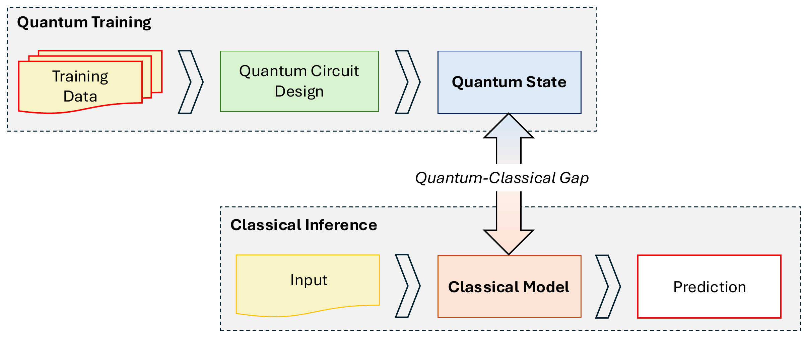

# QCAR: Quantum-to-Classical Ambiguity Resolution

Code and data for **"QCAR: Quantum-to-Classical Ambiguity Resolution for Reconstructing Classical
Predictors from Amplitude-Encoded Regression States"** by Van Tien Nguyen and Panagiotis
Markopoulos (The University of Texas at San Antonio).

Amplitude-encoded quantum regression algorithms (HHL, VQLS) return a normalised quantum state,
not a classical weight vector. Computational-basis measurements reveal coordinate magnitudes but
lose the signs and the norm. QCAR takes those magnitude-only measurements and recovers the
missing signs and scale by optimising the original ridge-regression objective:

1. it eliminates the scale in closed form;
2. it reduces sign recovery to a binary generalised Rayleigh quotient (BGRQ);
3. it solves the BGRQ by exact search, greedy bit-flipping, or Dinkelbach–QAOA.

The result is a portable classical model that needs no further quantum access.

<p align="center"></p>

## Contents

```
qcar/                  Python package
  model.py             QCAR estimator (state preparation → measurement → sign/scale recovery)
  linear_system.py     padded ridge system A'w' = b'
  quantum/             HHL and VQLS state preparation (+ Apache-2.0 Qiskit-derived components)
  sign_recovery/       BGRQ objective, exact search, bit-flip search, Dinkelbach–QAOA
  backends.py          Aer sampling and IBM Quantum sampling (credentials from environment)
  baselines.py         closed-form ridge (CI) and conjugate gradient (CGD)
  datasets.py          Diabetes and Student Performance preprocessing
  metrics.py           NSD and probability fidelity
experiments/           scripts that ran Experiments 1–3 (paper settings are the defaults)
analysis/              regenerate every table and figure from per-run result files
results/               archived per-run results behind the paper + raw IBM job data (see results/README.md)
tests/                 unit tests and regression tests against the archived numbers
```

## Installation

Python 3.11 or newer; the paper's runs used Python 3.13.5.

```bash
git clone https://github.com/vantnprof/QCAR.git
cd QCAR
python -m venv .venv && source .venv/bin/activate
pip install -r requirements.txt      # exact versions used for the paper
pip install -e .
pytest                               # ~1 min; includes an offline IBM-hardware path test (FakeTorino)
```

## Reproduce the tables and figures (about a minute, no quantum resources)

```bash
make reproduce
# equivalent to:
python -m analysis.make_tables      # -> outputs/tables/*.{csv,md,tex}
python -m analysis.make_figures     # -> outputs/figures/*.{pdf,png}
```

Both commands read only the per-run CSV files in `results/` and compute every number from
them. Nothing is filtered, smoothed or overridden. Tables report the mean ± standard deviation
over runs; figure error bars are 95% confidence intervals of the mean.

| Paper item | Generated file(s) | Source data |
|---|---|---|
| Table 2 (Exp. 1) | `outputs/tables/table2_exp1_synthetic.*` | `results/exp1/exp1_D{8,16}_detailed.csv` |
| Figs. 2–3 (Exp. 1) | `outputs/figures/fig_exp1_{fidelity,hhl_objective,vqls_objective,qaoa_energy}_d{8,16}.*` | same |
| Tables 3–4 (Exp. 2) | `outputs/tables/table{3,4}_exp2_{diabetes,student}.*` | `results/exp2/{diabetes,student}_exp2_results.csv` |
| Figs. 4–5 (Exp. 2) | `outputs/figures/fig_exp2_{diabetes,student}_{fidelity,r2,nsd}.*` | same |
| Table 5 (Exp. 3) | `outputs/tables/table5_exp3_backends.*` | `results/exp3/diabetes_{simulator,ibm_torino}_exp3_detailed.csv` |
| Fig. 6 (Exp. 3) | `outputs/figures/fig_exp3_{qaoa_energy,bgrq_objective}.*` | same, raw job data in `results/exp3/ibm_torino_jobs/` |

The tables include the bit-flip (BF) solver, which was run on every instance alongside exact
search (ES) and D-QAOA.

## Re-run the experiments

Prepare the real datasets once. Diabetes ships with scikit-learn; Student Performance is
downloaded from the [UCI repository](https://archive.ics.uci.edu/dataset/320/student+performance).
The script checks that the processed data reproduce the archived reference model.

```bash
python -m experiments.prepare_data
# offline: python -m experiments.prepare_data --student-csv /path/to/student-mat.csv
```

Each command below uses the paper's settings by default (see `--help`). It writes to `runs/`
with the same layout as `results/`, so `python -m analysis.make_tables --results-dir runs`
works on fresh runs.

| Experiment | Command | Runs | Wall time in 2025* |
|---|---|---|---|
| Exp. 1, D = 8 | `python -m experiments.exp1_synthetic --dimension 8` | 50 seeds | 8 min |
| Exp. 1, D = 16 | `python -m experiments.exp1_synthetic --dimension 16` | 50 seeds | 75 min |
| Exp. 2, Diabetes | `python -m experiments.exp2_shots --dataset diabetes` | 30 × 5 shot budgets | 45 min |
| Exp. 2, Student | `python -m experiments.exp2_shots --dataset student` | 30 × 5 shot budgets | 3 h |
| Exp. 3, simulator | `python -m experiments.exp3_backend --backend simulator` | 10 | 13 min |
| Exp. 3, hardware | `python -m experiments.exp3_backend --backend ibm --backend-name ibm_torino` | 10 (180 IBM jobs) | 2.3 h incl. queue |

\*16-core Linux workstation; all quantum circuits were simulated on CPU except the hardware run.

`make experiments` runs all simulator experiments. `make smoke` runs a reduced version of each
script end to end (about 5 minutes on a 2-core machine).

**Randomness.** Fresh runs are seeded: run `r` of an experiment uses seeds derived from `r`. A
fresh run is bit-for-bit reproducible on the same software stack. The archived 2025 runs were not
seeded, so a re-run reproduces their statistics but not their individual per-run values. The
classical references and the preprocessed data are deterministic and match the archive exactly.

### IBM Quantum hardware

No credentials are stored in this repository. Provide them through the environment:

```bash
export QISKIT_IBM_TOKEN="<API key>"
export QISKIT_IBM_INSTANCE="<instance CRN>"     # optional if your account has a default
python -m experiments.exp3_backend --backend ibm --backend-name ibm_torino
```

Raw sampler results (counts) for every hardware job are saved next to the result CSV. Use any
Heron-class backend available to you if `ibm_torino` is not. Before spending QPU time, the
hardware code path can be exercised offline: `pytest tests/test_hardware_path.py` runs it against
Qiskit's `FakeTorino` device model.

## Using the package

```python
from qcar import QCAR, ClosedFormRidge, nsd

model = QCAR(alpha=0.01, quantum_solver="vqls", sign_solver="bit_flip",
             state_shots=4096, max_iters=X.shape[1], seed=0).fit(X_train, y_train)
y_pred = model.predict(X_test)           # classical inference, no quantum access
print(nsd(model.coef_, ClosedFormRidge(0.01).fit(X_train, y_train).coef_))

# Sign/scale recovery from probabilities you measured elsewhere:
model = QCAR(alpha=0.01, sign_solver="exhaustive").fit(X_train, y_train, prob=p_hat)
```

`sign_solver` is one of `"exhaustive"` (exact; D ≲ 24), `"bit_flip"` or `"dqaoa"`;
`quantum_solver` is `"hhl"` or `"vqls"`; `backend` is `"simulator"` or `"ibm"`.

## Implementation details that matter when reading the results

- **Data.** Both real datasets use a fixed 80:20 split (`random_state=2602`), then degree-2
  polynomial features → PCA → standardisation (fitted on the training split) → an intercept
  column. This gives D = 16 for Diabetes (15 components) and D = 32 for Student (31 components),
  with no zero-padding. On the training split these features are orthogonal with equal norms
  (XᵀX = N·I up to rounding), so the BGRQ denominator is constant and its maximiser is
  `sign(Bᵀy)`.
- **State preparation.** VQLS uses a hardware-efficient R_y + CZ ansatz. Its global cost is
  evaluated exactly from the statevector, with A applied classically, and minimised with COBYLA.
  HHL implements exp(iAt) as an exact unitary and uses an exact reciprocal rotation. Only the
  trained or constructed circuit is sampled.
- **Stage 1.** Probabilities are renormalised over the D model coordinates (Eq. 7). For HHL this
  window also post-selects the flag qubit.
- **Sign solvers.**
  - **ES** enumerates the 2^(D−1) patterns with c₀ = +1.
  - **BF** is greedy best-improvement single-bit flipping from a random start, with at most D flips.
  - **D-QAOA** uses `QAOAAnsatz` with p = 3 and a random start. Each Dinkelbach step does the following:
    - It optimises the QAOA parameters with COBYLA on a local matrix-product-state simulator. Each
      energy is a 4096-shot estimate (Qiskit Runtime local-mode default precision 1/64).
    - It samples the optimised D-qubit circuit with S shots on the chosen backend.
    - It keeps the best of the `top_k` most frequent bitstrings.
  - **D-QAOA stopping.** The loop runs at most D steps and returns the last iterate.
- **Shot settings.**
  - Exp. 1: K = 1024 state shots; S = 10⁵ QAOA shots; top-k = 8.
  - Exp. 2: S = K; top-k = D.
  - Exp. 3: K = S = 4096; top-k = D = 16. On hardware, D-QAOA sampled 16-qubit circuits.

## Citation

If you use this code, please cite the paper (citation details will be updated on publication):

```bibtex
@article{nguyen2026qcar,
  title   = {{QCAR}: Quantum-to-Classical Ambiguity Resolution for Reconstructing Classical
             Predictors from Amplitude-Encoded Regression States},
  author  = {Nguyen, Van Tien and Markopoulos, Panagiotis},
  journal = {ACM Transactions on Quantum Computing},
  note    = {Submitted},
  year    = {2026}
}
```

See also `CITATION.cff`.

## License

MIT (see `LICENSE`). Files in `qcar/quantum/_qiskit/` are adapted from Qiskit and remain under
the Apache License 2.0 (see `NOTICE` and `LICENSE-APACHE-2.0.txt`).

## Contact

Van Tien Nguyen, tien.nguyen@utsa.edu · Panagiotis Markopoulos, panagiotis.markopoulos@utsa.edu
